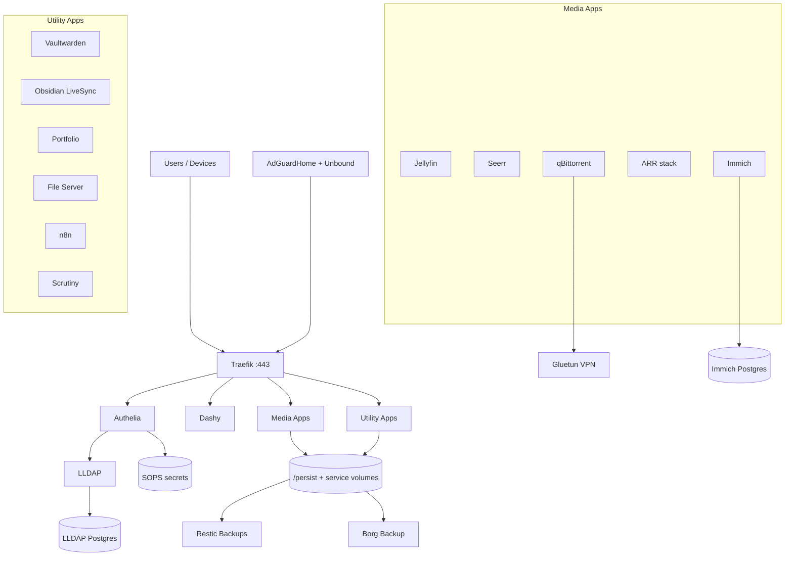

<div align="center">


**NixOS Configuration for QGroget Infrastructure**

*Reproducible, declarative systems for desktop computing and homelab services*


</div>

---

## 🏠 Why This Configuration Exists

This repository defines the full QGroget environment with **Nix flakes**:
- multiple desktop machines
- one main homelab server
- reusable modules under `modules/`

The goal is to keep systems reproducible, versioned, and easy to rebuild.

## 🗂️ Repository Structure

- `flake.nix`: host wiring, shared modules, checks
- `hosts/<name>/`: host-specific system configuration
- `modules/`: reusable modules (desktop, server, apps, services)
- `secrets/`: encrypted secrets managed with `sops-nix`
- `tests/`: NixOS integration checks

## 🖥️ Server Configuration (host: `Server`)

Server config is composed from:
- `hosts/Server/configuration.nix`
- `modules/server/default.nix`
- imported feature modules under `modules/server/*`

### Core platform
- **Ingress / TLS**: Traefik (Let's Encrypt, dynamic routers generated from `qgroget.services`)
- **Authentication**: Authelia + LLDAP (OIDC and LDAP)
- **Containers**: Podman + Quadlet
- **Persistence**: `/persist` + per-service persistent directories
- **Secrets**: SOPS (`secrets/secrets.yaml`) with runtime injection
- **Backups**: Restic coordinator + Borg backup job
- **Network services**: AdGuardHome + Unbound DNS

## 📦 Installed & Configured Server Services

### Access / Identity
- Traefik (`proxy.qgroget.com`)
- Authelia (`auth.qgroget.com`)
- LLDAP (`lldap.qgroget.com`)

### Media stack
- Jellyfin (`jellyfin.qgroget.com`)
- Seerr / Jellyseerr (`seerr.qgroget.com`)
- Immich (`immich.qgroget.com`)
- ARR stack: Sonarr, Radarr, Sonarr-anime, Radarr-anime, Bazarr, Prowlarr, Questarr, Qui

### Download / transfer
- qBittorrent instances (via Gluetun VPN)

### Utility / apps
- Dashy (`qgroget.com`)
- Vaultwarden (`vaultwarden.qgroget.com`)
- Obsidian LiveSync (`obsidian.qgroget.com`)
- Portfolio (`portfolio.qgroget.com`)
- File server (`file.qgroget.com`)
- Scrutiny (`scrutiny.qgroget.com`)
- n8n (`n8n.qgroget.com`)
- AdGuardHome (`adguardhome.qgroget.com`)
- Glances (`top.qgroget.com`)

### Hermes WebUI (native NixOS module)

`hermes-webui.qgroget.com` runs the upstream
[`nesquena/hermes-webui`](https://github.com/nesquena/hermes-webui) NixOS module
and package, pinned by the `hermes-webui` flake input. It is separate from the
existing built-in dashboard at `hermes.qgroget.com`.

- **Access:** Traefik HTTPS with the existing **mTLS client certificate** policy;
  the backend only listens on `127.0.0.1:8787`, with no new firewall port.
- **Agent:** browser chat uses the existing container's authenticated gateway at
  `127.0.0.1:8642`, with the Runs API enabled for approval prompts. No second
  gateway, host-side Agent installation, or boot-time package download is added.
  The Agent binds `API_SERVER_HOST=0.0.0.0` **inside the honcho pod**, with
  `API_SERVER_PORT=8642`; Podman publishes only `127.0.0.1:8642:8642` on the host.
  Pod loopback alone cannot receive traffic forwarded from the host WebUI.
  No public host listener or firewall port is added; chat still requires the
  shared runtime `API_SERVER_KEY`.
  Features requiring local Agent Python modules are not provided by this split
  deployment; use the existing dashboard/Agent for those operations.
- **State:** the service reserves UID/GID `10000` to match the Agent's existing
  data ownership. A private systemd bind exposes `/persist/hermes` as `/opt/data`
  inside the service, preserving profile/workspace paths. WebUI-specific state
  lives in persisted `/var/lib/hermes-webui`. Both directories are backed up by
  the Restic coordinator, which stops the three Hermes writers for consistency.
- **Secrets:** the existing SOPS environment file is injected at runtime. The
  gateway key generated by the Agent in its shared home `.env` is read by the
  WebUI's profile loader; no key is copied into Nix expressions or the store.
- **Updates:** update the pinned input through a PR and rebuild; do not use the
  WebUI's in-app source/Agent updater against immutable Nix packages. Upstream's
  launcher currently requires a local Agent even in gateway mode, so the module's
  `ExecStart` is narrowly overridden to launch its packaged `server.py` with Nix
  Python dependencies. Users, environment mapping and service lifecycle still
  come from the upstream module.

After merging/deploying, use a configured client certificate to open
`https://hermes-webui.qgroget.com`. Inspect the service with
`systemctl status hermes-webui.service` and `journalctl -u hermes-webui.service`.
The PR/build checks do not activate the service or send a billable LLM request.

If WebUI lists existing chats but reports **Gateway endpoint not reachable**,
listing chats only proves the shared state is readable. Check
`curl --fail http://127.0.0.1:8642/health` on the host, then
`curl --fail http://127.0.0.1:8787/api/health/agent` (`alive` must be `true`).
The pinned WebUI selects its health base URL in this order:
`GATEWAY_HEALTH_URL`, `HERMES_GATEWAY_HEALTH_URL`, `HERMES_API_URL`, then
`HERMES_WEBUI_GATEWAY_BASE_URL` (configured here). It normalizes a trailing
`/health` and probes `/health/detailed` with the shared Bearer key before falling
back to public health paths. Do not point it at the mTLS browser hostname.
If pod-local `/health` succeeds but the host request fails, verify the Agent's
bind address, not just the published port. Applying the bind fix requires an
authorized rebuild/activation that recreates the Agent container; a WebUI-only
restart cannot change the gateway's network listener. The PR itself does not
deploy or restart either service.

## 🕸️ Architecture Graph



## 🚀 Quick Start

```bash
# Clone
git clone https://github.com/Strange500/nixos-config.git ~/nixos

# List outputs
nix flake show ~/nixos

# Build and switch (replace hostname)
sudo nixos-rebuild switch --flake ~/nixos#Server
```

## ✅ Checks

```bash
# Native Hermes WebUI module/config assertions + isolated HTTP smoke test
nix build .#checks.x86_64-linux.hermesWebuiTest

# Example flake check targets
nix build .#checks.x86_64-linux.jellyfinTest
nix build .#checks.x86_64-linux.jellyseerrTest
```
